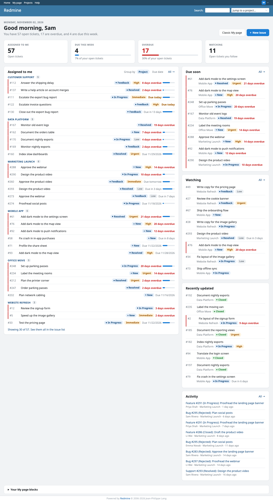
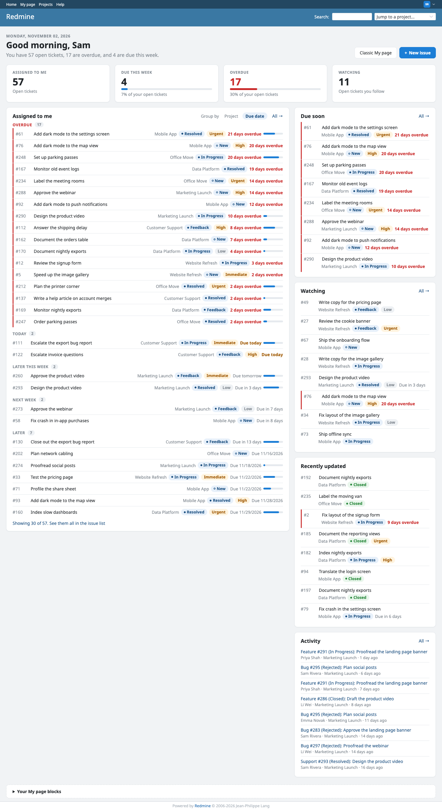
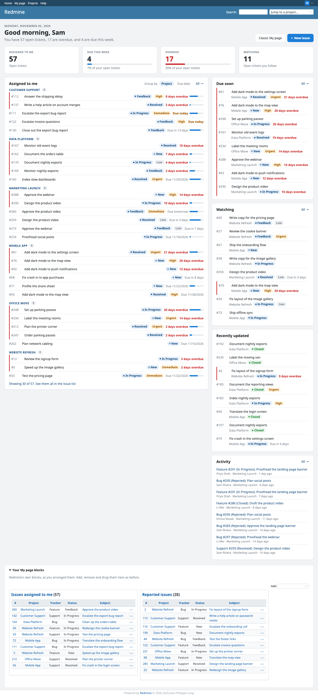
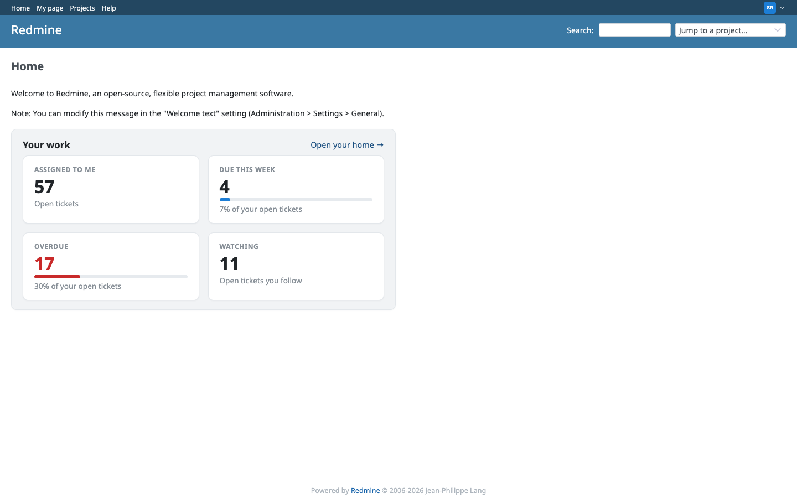
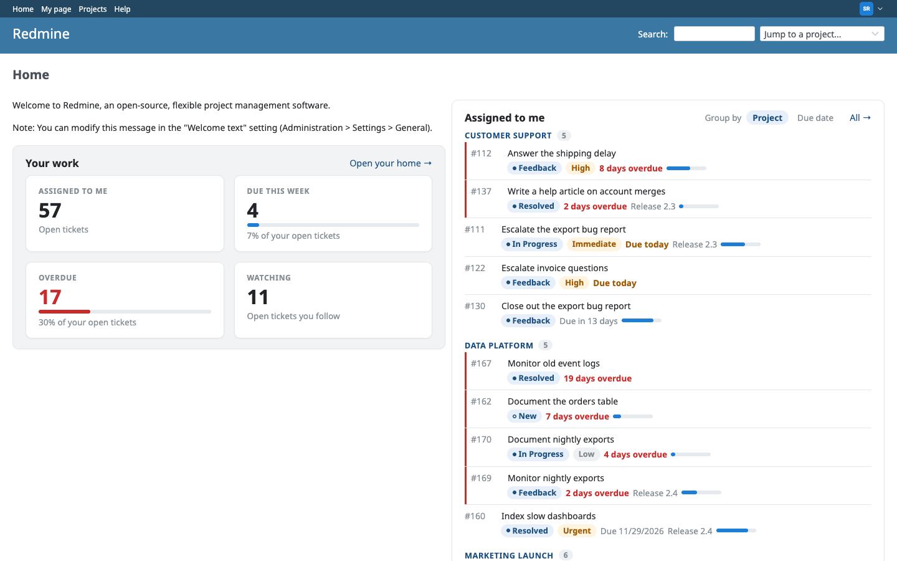
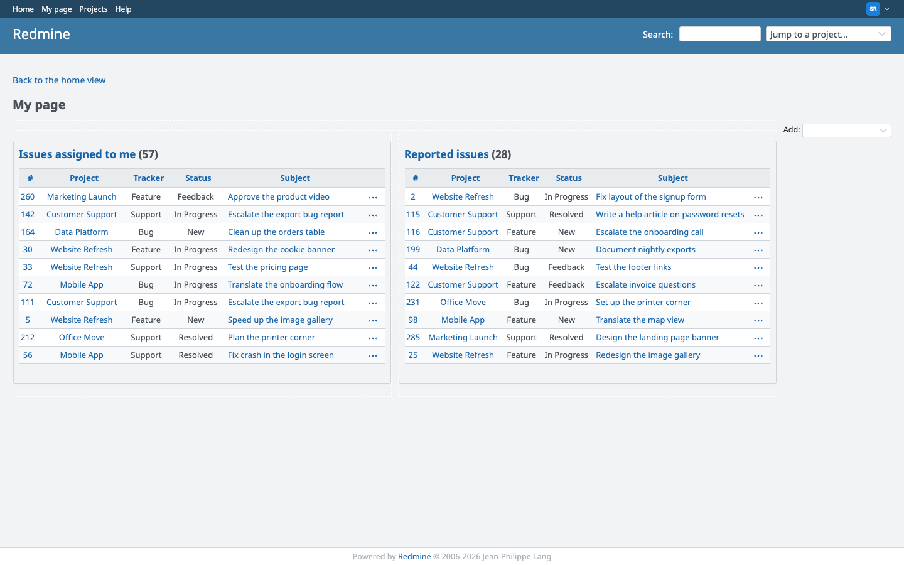
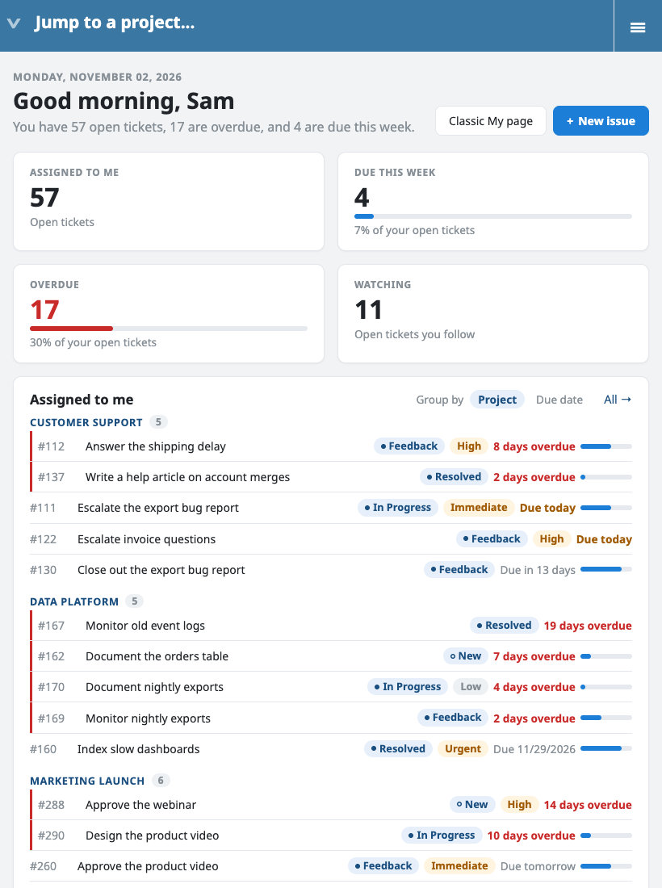

# Rubylode Home for Redmine

TL;DR: a My page for [Redmine](https://www.redmine.org) that shows what's assigned to you, what's due, what's overdue and
what you watch, on one page.

Status: version 1.2.1. `docs/roadmap/ROADMAP.md` lists what is built and what is open, and "Compatibility and known
limits" below lists what doesn't work yet.

Contents:

- [What it does](#what-it-does)
- [Installation](#installation)
- [Settings](#settings)
- [Try it](#try-it)
- [Restyling it](#restyling-it)
- [Compatibility and known limits](#compatibility-and-known-limits)
- [Tests](#tests)
- [Releasing](#releasing)
- [License](#license)

## What it does

My page (`/my/page`, where Redmine sends you after login) becomes a home view with:

- A greeting with today's date and one sentence on where you stand.
- Four tiles: open tickets assigned to you, due this week, overdue, and open tickets you watch. Each tile links to the
  issue list holding exactly those tickets, so the number and the list agree.
- An Assigned to me card, grouped by project or by due date (overdue, today, later this week, next week, later, no due
  date), with status and priority chips, a short due label ("2 days overdue", "Due in 3 days"), a small progress bar,
  and a red edge on overdue rows. Normal priority gets no chip, so the unusual ones stand out.
- Side cards: Due soon (overdue and the next two weeks), Watching, Recently updated (tickets you wrote, commented on or
  are assigned to) and a compact Activity list.
- A line on every empty card that says what would fill it.
- A New issue button, shown when you may add tickets somewhere.

The welcome page (`/`) shows a signed-in person the same four tiles and a link to their home. A setting can add their
open tickets there too (see [Settings](#settings)).

Redmine's own My page blocks stay at the bottom under "Your My page blocks", collapsed, and still work as before (add,
remove, drag to reorder). `/my/page?view=classic` shows them alone.

Every list goes through Redmine's own visibility rules, so a ticket you can't open never shows. A test checks that the
query count does not grow with the number of tickets. Weeks start on the day set in Administration, Settings, Display
(or your language's default).

| Grouped by due date | Your own blocks, opened | Welcome page, tiles |
|---|---|---|
|  |  |  |

The welcome page with the tickets option on (made-up demo data):

| Classic fallback (`?view=classic`) | Narrow screen |
|---|---|
|  |  |

All screenshots show the made-up demo data from `script/seed_demo.rb`.

## Installation

Redmine 5.1 or newer, on any database Redmine supports. The plugin adds no table. The folder must be named
`redmine_rubylode_home`, the same as the plugin id.

1. Put the plugin in your Redmine's `plugins` folder:

       cd /path/to/redmine/plugins
       git clone https://github.com/rubylode/redmine-rubylode-home.git redmine_rubylode_home

2. Restart Redmine ([Passenger](https://www.phusionpassenger.com), [Puma](https://puma.io) or whatever serves it).

3. Open My page.

With [Docker](https://www.docker.com), mount or copy the plugin to `/usr/src/redmine/plugins/redmine_rubylode_home`
and restart the container.

To upgrade, `git pull` and restart. The settings below default to the old behaviour, so an upgrade changes nothing until you choose.

To remove it, delete the folder and restart. Nothing is stored in the database, so there is nothing to clean up.

## Settings

Administration, Plugins, Rubylode Home, Configure. A bad value shows the problem and saves nothing.

| Setting | Choices | Default | What it does |
|---|---|---|---|
| Welcome page content | The four tiles, or the tiles and my open tickets | The four tiles | With the second choice a signed-in person also gets the Assigned to me card on the welcome page: their open tickets, grouped by project or by due date (the same Group by control as My page, kept in the address as `?group=`). Each row shows the ticket number, subject, status, priority chip, due date or overdue badge and the milestone (target version) when there is one. Up to 30 rows, then "Showing 30 of N. See them all in the issue list". Only tickets the person may see. `?view=classic` on My page is not affected. |
| Column for the tickets | Left, right | Right | Which of Redmine's two welcome page columns holds the tickets block. The tiles stay on the left. |
| Show dates without times in issue lists | On, off | Off | The created, updated and closed columns of the issue list, and the "Added by" and "Updated by" lines on an issue page, show the date only, in each person's date format (the due date column already is one). Only Redmine's own issue columns change; columns from other plugins, and other lists, keep their times. |

## Try it

A throwaway Redmine 7 runs from this folder on http://localhost:3010, with the repository mounted as the plugin:

    bin/demo up        start it and load the demo data (six projects, six people, 300 made-up tickets)
    bin/demo restart   pick up a change to the plugin (it runs in production mode)
    bin/demo down      stop it, keep the data
    bin/demo reset     stop it and wipe the data

Sign in as `sam.rivera` with the password `demo-password-1` to see a well-filled home, or as admin / admin. The
other demo people are jordan.lee, priya.shah, marco.bianchi, emma.novak and li.wei, with the same password. Running
`bin/demo up` again changes nothing. Never point the seed script at a real tracker.

## Restyling it

Every colour, radius and gap is a CSS custom property on `.rubylode-home` (`--rubylode-home-accent`,
`--rubylode-home-card-background`, `--rubylode-home-warning` and so on, listed at the top of
`assets/stylesheets/rubylode_home.css`). A theme restyles the page by setting them. Where Redmine 7 has its own colour
variable (`--oc-*`) the default follows it. The plugin has no JavaScript.

The variables: `--rubylode-home-accent`, `-accent-soft`, `-accent-strong`, `-bar-fill`, `-bar-track`,
`-card-background`, `-card-border`, `-card-radius`, `-card-shadow`, `-caution`, `-caution-soft`, `-chip-radius`, `-gap`,
`-neutral-soft`, `-page-background`, `-success`, `-success-soft`, `-text`, `-text-muted`, `-warning` and `-warning-soft`,
each with the `--rubylode-home` prefix. For example, in a theme's stylesheet:

    .rubylode-home { --rubylode-home-accent: #6b3fa0; --rubylode-home-card-radius: 4px; }

## Compatibility and known limits

- Redmine 5.1 or newer. Tested in CI with the Rubylode plugins' own test suites on Redmine 7.0, 6.1, 6.0 and 5.1. Older versions are not supported.
- "Due this week" means up to the end of the calendar week, with the first day taken from Redmine's "Start calendars on"
  setting. Late in the week it is a short window: on a Saturday it covers two days. Overdue tickets are counted in
  "Overdue" only.
- The plugin replaces Redmine's `my/page` view. Another plugin or theme that replaces the same view will clash, and
  whichever loads last wins. Use `?view=classic` or remove one of them.
- There is no dark mode. The stylesheet has no dark palette; a theme can supply one through the custom properties.
- Layout, wording and colours may still change. `docs/roadmap/ROADMAP.md` lists what is open.
- The Overview (project page) and My tickets are not changed yet.
- The plugin has three settings (above) and no permissions of its own. Only the English locale ships.
- The welcome page tickets block uses the same queries as My page, so it shows at most 30 tickets however you group them.
- With dates without times on, the lines above an issue and its comments read "Added by Jo on 11/02/2026" instead of "3 days ago". The "Updated ... ago" line at the top of the issue page keeps its age.

## Tests

    bin/test                                       all unit and integration tests
    bin/test test/integration/home_page_test.rb    one file

The rules (what counts as overdue or due this week, the groupings, the tile numbers) have unit tests. The pages have
integration tests, one of which checks that the number of queries does not grow with the number of tickets. They run
in a Redmine 7 image with its test gems (`docker/test.Dockerfile`) and send the requests a browser would send.

Pull Requests are welcome!

## Releasing

Push a `vX.Y.Z` tag whose version matches `version` in `init.rb` and has an entry in `CHANGELOG.md`. CI runs the tests, builds `redmine_rubylode_home-X.Y.Z.zip` and publishes the GitHub release with the changelog entry as its notes. To build a release for a tag that already exists, use Actions, release, Run workflow.

The text for the www.redmine.org listing, and how to read the result of Check for updates, is in [docs/redmine-org-listing.md](docs/redmine-org-listing.md).

## License

GNU General Public License, version 2 or (at your option) any later version, the same as Redmine. See `LICENSE`.

Copyright (C) 2026  Nick Gorbikoff

No warranty, as the GPL says. The plugin replaces the My page view, so try it on a copy of your tracker before the real one.
